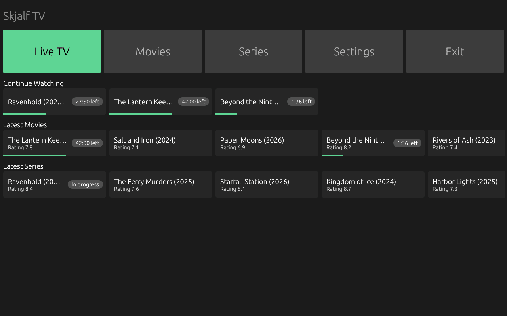
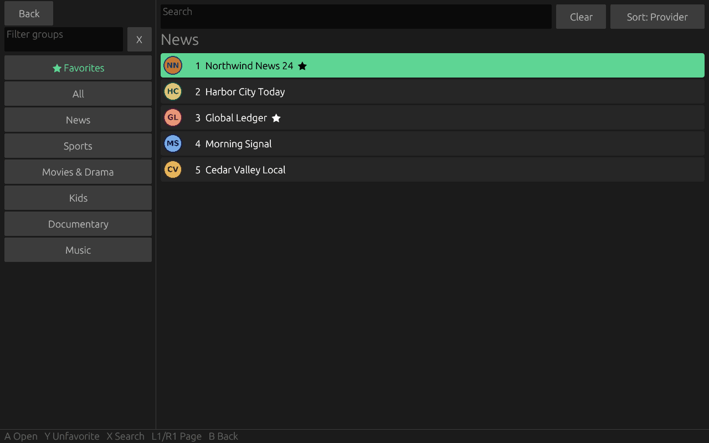
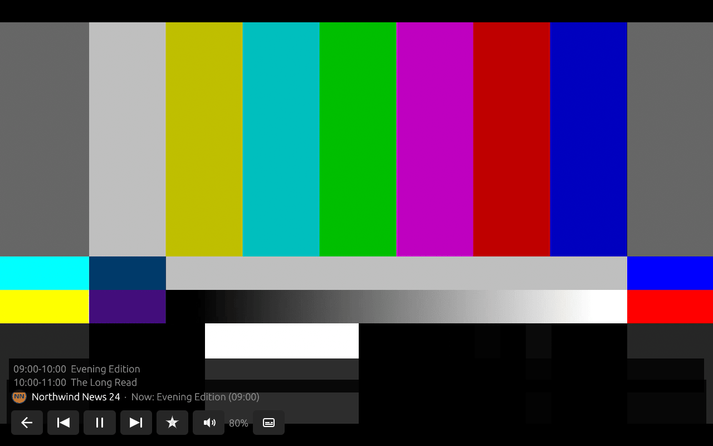
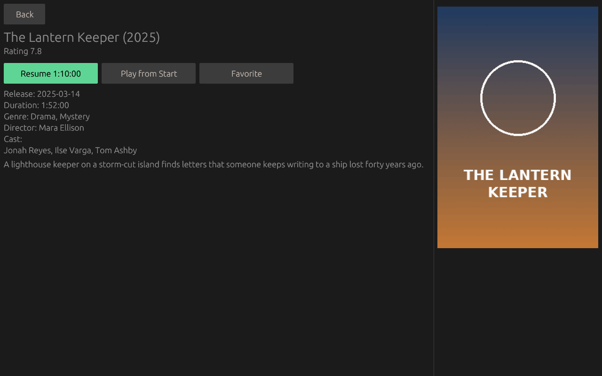
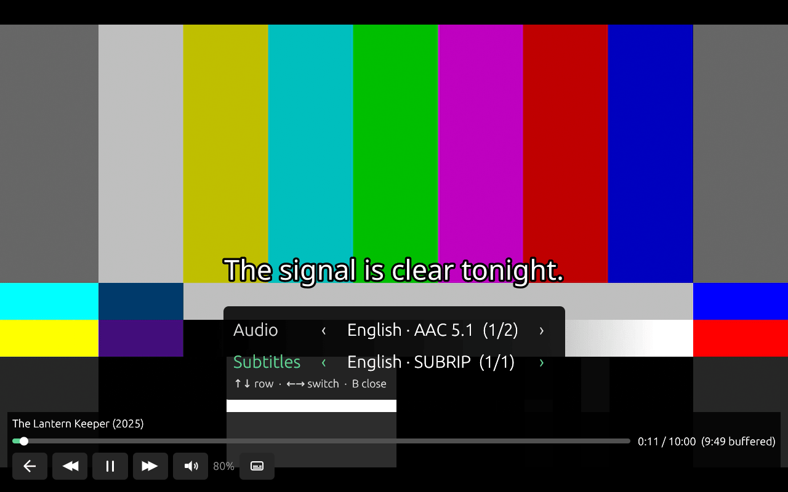

<p align="center"></p>

# Skjalf TV

Skjalf TV is an IPTV player for the Steam Deck and Linux desktops. It plays live TV, movies, and series from an Xtream Codes provider or an M3U playlist. You control it with the Deck's buttons, a touch screen, or a keyboard. The app is written in Rust with egui and libmpv.

The name comes from Hliðskjálf, the high seat from which Odin watches all nine worlds.

Skjalf TV contains no channels or content. You need your own IPTV subscription or playlist.

<a href="https://alternativeto.net/software/skjalf-tv/about/?utm_source=badge&utm_medium=referral"></a>



| Live TV with channel logos | The live player with program information |
|---|---|
|  |  |
| **Movie details with the poster** | **Audio and subtitle choice in the player** |
|  |  |

The screenshots show the app at the Deck's resolution of 1280x800, connected to a test server with made-up titles and generated artwork.

## Features

- Live TV with channel groups, search, name sort, favorites, channel numbers, and channel zapping.
- A movie and series library that stays fast with catalogs of more than 180,000 titles.
- Details screens with posters, ratings, genres, plot, seasons, and episodes.
- Posters on the Main rows and channel logos in Live TV. A movie or series without a poster shows a frame from the video.
- Resume where you stopped. Main shows a Continue Watching row and the latest movies and series.
- Watched and in-progress markers in every list.
- Favorite channels, movies, series, and whole groups. Favorite groups appear at the top of the group list.
- A group filter. For example, type "SI|" to show only the Slovenian groups.
- A standard transport bar: play, pause, seek, previous and next channel, volume, favorite, and audio and subtitle tracks.
- Audio and subtitle selection. Set your audio language and subtitles once in Settings, and every stream tries them. Change the tracks of one stream in the player.
- In Game Mode, the Steam on-screen keyboard opens automatically for text fields.
- Correct right-to-left text for Arabic and Persian titles, and emoji in channel and group names.
- Buffering for slow connections. A movie or episode can wait until up to 30 minutes of video is buffered, and playback can wait again after a stall.
- Automatic refresh of the provider data. The default interval is 24 hours.
- Scaling for the Deck screen (1280x800) and for a TV at 1920x1080.

[CHANGELOG.md](CHANGELOG.md) lists the changes in each release.

## Controls

| Steam Deck | Keyboard | Action |
|---|---|---|
| D-pad or left stick | Arrow keys | Move the focus |
| A | Enter | Open or select |
| B | Esc or Backspace | Go back |
| X | E | Search in a list. Show program information in the live player. |
| Y | F | Add or remove a favorite |
| L1 and R1 | Page Up and Page Down | Move one page in a list. Change the channel in the live player. |
| Number keys | Digits | Go to a channel number in Live TV |
| View | O | Open or close the audio and subtitle panel in the player |

A hint line at the bottom of every list shows the buttons for the focused control.

In the live player, Up and Down change the channel and Left and Right change the volume. Press Down to move the focus into the transport bar.

In the movie and episode player, A pauses and resumes playback. Left and Right seek 10 seconds, and L1 and R1 seek 60 seconds.

### Audio and subtitles

Open Settings to set the languages for every stream:

- Audio Language: the audio track to play. "Stream default" plays the track that the provider marks as the default.
- Subtitles: On or Off. Subtitles are off until you turn them on.
- Subtitle Language: the subtitles to show while Subtitles is On. "Stream default" shows the provider's default subtitle track, or the first one.

Each stream tries these languages. If a stream does not have your audio language, it plays its default audio. If it does not have your subtitle language, it shows no subtitles.

To change the tracks of the stream that plays now, press View, or select the subtitle icon at the right end of the transport bar. In the panel, Up and Down choose Audio or Subtitles, and Left and Right change the track. B closes the panel. The change lasts until the stream ends. The next stream uses the languages from Settings again.

To type a search, press X. Type with the Steam keyboard, then press Enter or B to finish.

## Install on a Steam Deck

1. Hold the power button and select Switch to Desktop.
2. Open Konsole from the application menu.
3. Run this command:

   ```sh
   curl -fsSL https://github.com/bikemazzell/skjalf-tv/releases/latest/download/install.sh | sh
   ```

4. Select Return to Gaming Mode on the desktop. Skjalf TV is in the library under Non-Steam.

The installer downloads the latest release and checks its SHA-256 checksum. If Steam is open, the installer closes it first, because Steam overwrites shortcut changes that it does not expect. The installer then downloads the pinned SteamOS playback libraries from Valve's package server and checks each hash. It puts the app in `~/.local/share/skjalf`, adds a menu entry, and adds a Steam shortcut with an icon and library artwork. It backs up `shortcuts.vdf` before it changes it, and it never changes other shortcuts.

To update Skjalf TV, run the same command again. Your settings, favorites, and watch progress stay.

To read the script before you run it, download it first:

```sh
curl -fsSLO https://github.com/bikemazzell/skjalf-tv/releases/latest/download/install.sh
less install.sh
sh install.sh
```

### Uninstall

In Desktop Mode, run:

```sh
curl -fsSL https://github.com/bikemazzell/skjalf-tv/releases/latest/download/uninstall.sh | sh
```

The uninstaller removes the app, its menu entry, and its Steam shortcut and artwork. It keeps your settings in `~/.config/skjalf`. To remove those too, including your saved provider credentials, add `-s -- --purge` after `sh`.

### Install from source

Build `skjalf` as described in "Build", copy the source tree and the binary to the Deck, close Steam, and run:

```sh
packaging/install-steamos.sh /absolute/path/to/skjalf
```

To reuse downloaded packages, set `SKJALF_PACKAGE_CACHE` to the directory that holds them. To use your own libmpv build, set `SKJALF_MPV_LIB_DIR` to a directory that contains `libmpv.so.2`. The installer then skips the download.

### Play on a TV

When the Deck is docked to a TV, open the Skjalf TV properties in Steam and set "Game resolution" to Native. Start the app after you connect the TV. If you do not, the app renders at 1280x800 and Steam enlarges the picture.

## First start

1. Choose Xtream Codes or M3U.
2. Enter the server, user name, and password, or the playlist URL.
3. Select Connect.

To change the source later, open Settings and select Edit Source. Settings also has Refresh Content and the refresh interval: Off, 6 hours, 12 hours, 24 hours, 48 hours, or 7 days.

The User Agent row sets the name that the app sends with each request to your provider. The default is `SkjalfTV/` and the version number. Some providers serve only known players. If yours refuses the app, select User Agent and type the name of a player that your provider accepts. Clear the field to return to the default.

### Posters and captured frames

The app shows the posters, covers, and logos that your provider lists, and keeps them in `~/.cache/skjalf/art` (or `$XDG_CACHE_HOME/skjalf/art`), up to 300 MiB. When the cache is full, the images that were used least recently go first.

When a movie or series has no poster, its details screen captures one frame from about 10% into the video and keeps it in the same cache. A capture opens the stream, so it uses one of your provider's connections for a few seconds. The app captures only while nothing plays, only when your account has a free connection, and at most once per title. Play or Back cancels a capture.

### Slow connections

If video stops often to buffer, open Settings and change these values:

- Buffer Before Playback: a movie or episode waits until this much video is buffered. The choices are Off, 1, 2, 5, 10, 20, or 30 minutes. Live TV does not wait, because a live stream arrives in real time.
- Buffer After a Stall: when playback stops to buffer, it continues after this much video is buffered. The choices are from 1 second to 10 minutes. This setting applies to live TV too.

While playback waits, the screen shows the progress. Press A to start playback at once with the video that is already buffered. The transport bar shows how much video is buffered ahead.

The buffer is a temporary file in `~/.cache/skjalf` (or `$XDG_CACHE_HOME/skjalf`), up to 4 GiB. The player deletes the file name as soon as it opens the file, so the space is free again when playback ends.

## Privacy

Skjalf TV keeps your settings, favorites, watch progress, and cached catalogs in `~/.config/skjalf` (or `$XDG_CONFIG_HOME/skjalf`). These files contain your provider address and credentials. The app creates them readable only by your user. Treat the whole directory as private.

The app sends data only to your provider and to the image servers that your provider lists for posters and logos. These can be other servers, for example an image service. An image request tells that server your IP address and the app's User-Agent, but not your provider credentials. The app does not write your credentials to logs or error messages.

## Build

You need Rust 1.90 or later. A development script downloads libmpv packages into `.deps/mpv`. These libraries are for builds and tests on the workstation only, not for SteamOS.

```sh
./scripts/fetch-mpv-deps.sh
export MPV_LIBRARY_DIR="$PWD/.deps/mpv/usr/lib/x86_64-linux-gnu"
export LIBRARY_PATH="$MPV_LIBRARY_DIR"
export LD_LIBRARY_PATH="$MPV_LIBRARY_DIR"
export PKG_CONFIG_PATH="$MPV_LIBRARY_DIR/pkgconfig"
cargo build --release -p skjalf
```

The binary is `target/release/skjalf`.

## Tests

```sh
cargo test --workspace --locked
cargo test -p skjalf --test mpv_integration --locked -- --ignored --test-threads=1
cargo fmt --check
cargo clippy --workspace --all-targets --locked -- -D warnings
```

The `mpv_integration` tests play generated clips through the real libmpv. The packaging tests need a release binary and the libmpv directory:

```sh
SKJALF_TEST_BINARY="$PWD/target/release/skjalf" \
SKJALF_TEST_MPV_LIB_DIR="$MPV_LIBRARY_DIR" \
SKJALF_TEST_NETWORK=1 \
python3 -m unittest discover -s packaging/tests -v
```

Without `SKJALF_TEST_NETWORK=1`, the test that downloads the SteamOS runtime is skipped. The packaging tests write only to temporary directories.

Tests never start the real Steam client. To check this, put a fake `steam` script that logs its arguments first on `PATH`. Then run the tests and make sure that the log is empty.

### Screenshots

The README screenshots come from a fake Xtream server with made-up titles and generated artwork. To take them again, build the release binary and run:

```sh
scripts/screenshots/shoot.sh
```

The script runs the app on an invisible Xvfb display, so no window opens on the desktop, and writes the images to `docs/screenshots`. It needs Xvfb, xdotool, ImageMagick, pngquant, ffmpeg, Python with Pillow, the DejaVu fonts, and libmpv. Its scratch files go to `target/screenshots`. If the app does not reach the expected screen, the script stops and leaves the old images in place.

## Project layout

| Path | Contents |
|---|---|
| `crates/core` | Logic without a display: provider parsing, catalogs, search, favorites, progress, and storage |
| `crates/app` | The egui app: views, input, the libmpv player, and the Steam keyboard |
| `packaging` | The SteamOS installer, runtime lock file, Steam shortcut writer, icons, and their tests |
| `scripts` | The libmpv download for development, and the screenshot kit |
| `.github/workflows` | Continuous integration and the release build |
| `docs/screenshots` | The screenshots in this README |

## Icons and artwork

The icon shows a TV whose antenna is the rune Algiz (ᛉ), with Odin's all-seeing eye on the screen. The SVG sources are in `packaging/icons`. To render the PNG files again, run `packaging/icons/render.sh`. It needs `rsvg-convert` and the Ubuntu font.

The app includes the Noto Emoji font (version 3.002) in `crates/app/assets/fonts`. It is under the SIL Open Font License; see `NotoEmoji-OFL.txt` in the same directory.

## License

MIT. See [LICENSE](LICENSE).
